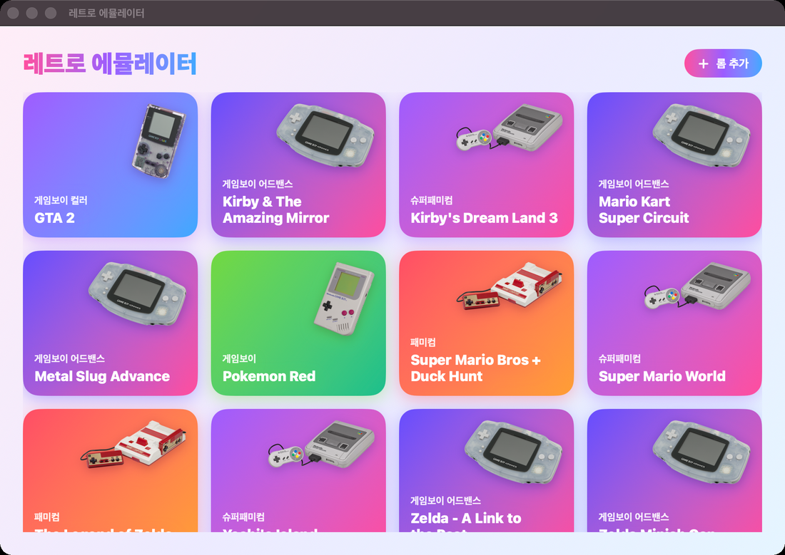
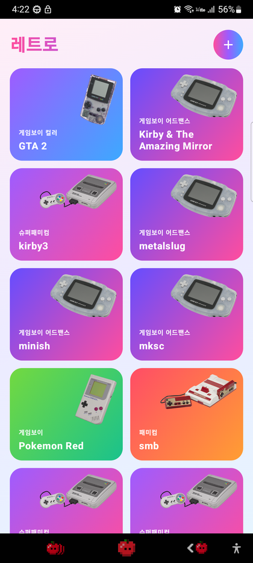
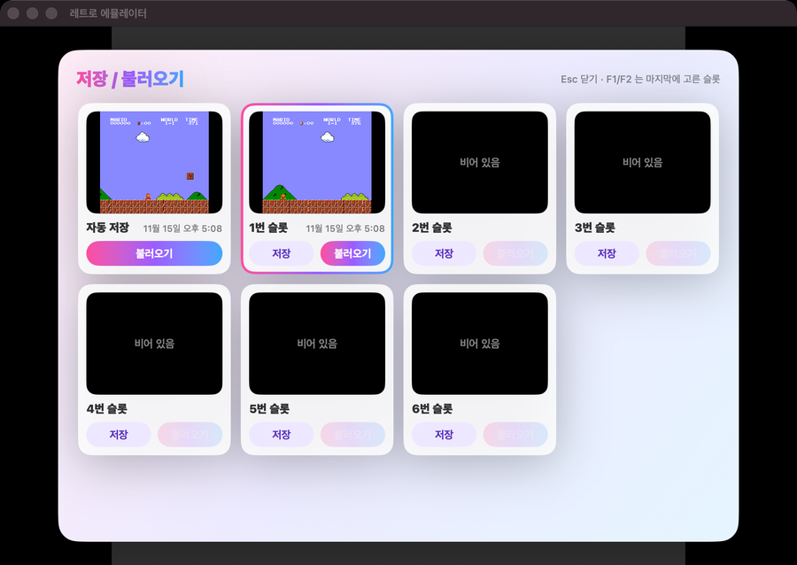
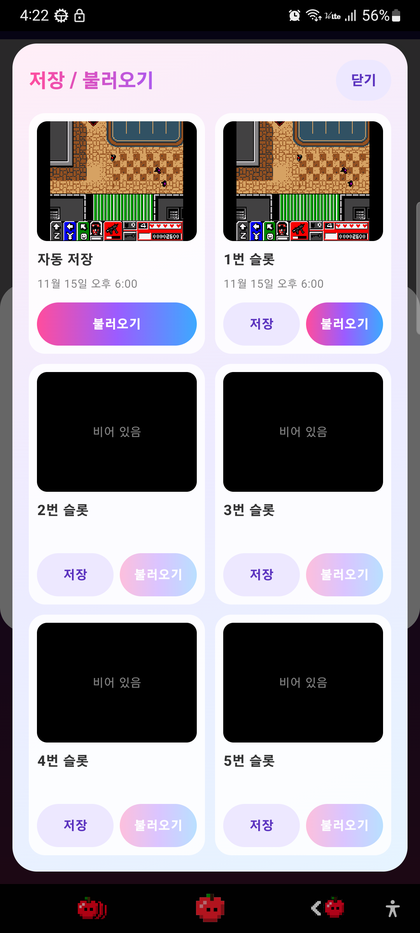
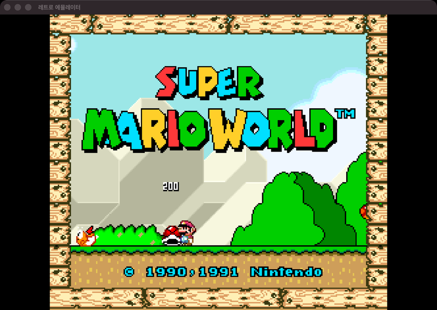
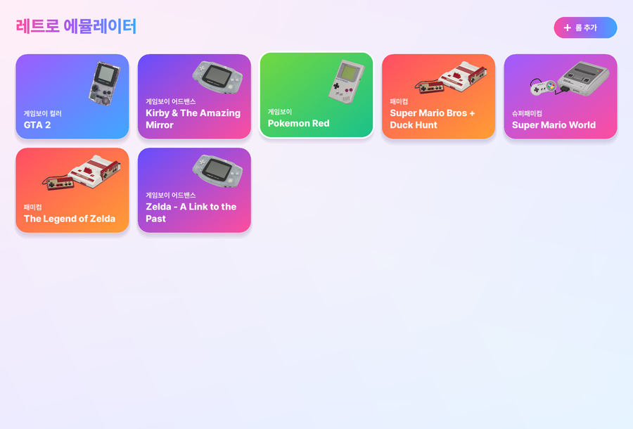
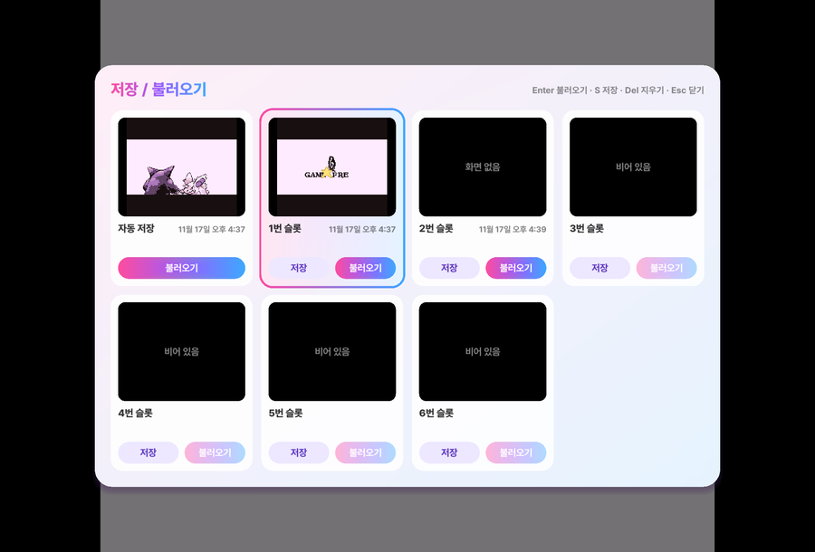
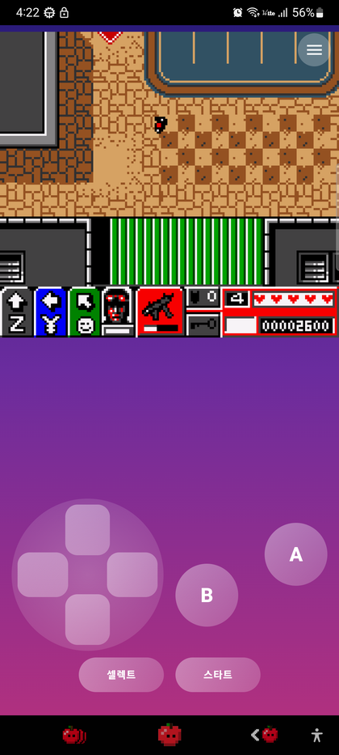
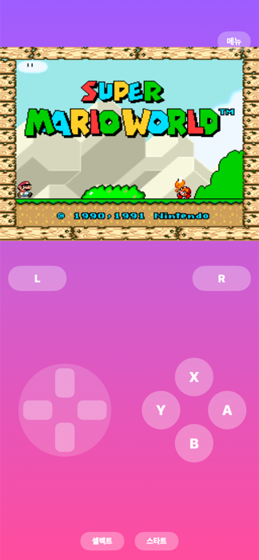
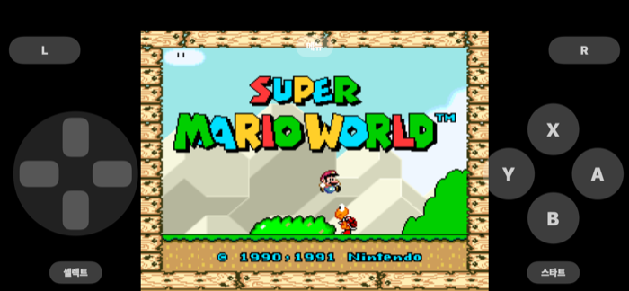

# retro-emu

English · [한국어](README.md)

A retro game emulator for macOS, Windows, Android and iOS. The emulation itself is done by [libretro](https://www.libretro.com/) cores. This repository holds a small host that loads a core and handles video, audio, input and saving, plus the four apps built on top of it.

Download the macOS dmg, Windows zip, Android apk and iOS ipa from [Releases](https://github.com/wqrvQ2WR/retro-emu/releases).

<p>
  
  
</p>

## Supported systems

| System | Extensions | Core |
|---|---|---|
| NES / Famicom | `.nes` `.fds` `.unf` | FCEUmm |
| Game Boy | `.gb` | mGBA |
| Game Boy Color | `.gbc` | mGBA |
| Game Boy Advance | `.gba` | mGBA |
| SNES / Super Famicom | `.sfc` `.smc` `.swc` `.fig` | Snes9x |
| Mega Drive / Genesis | `.md` `.gen` `.smd` `.bin` | Genesis Plus GX |
| PlayStation | `.cue` `.chd` `.pbp` `.m3u` | PCSX ReARMed |

- No ROMs are included. Bring your own.
- PlayStation runs without a BIOS (HLE), so compatibility is limited. Put `scph5501.bin` in the system folder if you have one.
- Game Boy games use Super Game Boy palettes but drop the border, so the picture is bigger.

## Features

### Saving

<p>
  
  
</p>

- Every game has **6 save slots plus 1 auto-save slot**. Each slot keeps a screenshot and the time it was saved.
- If you play for more than 5 seconds, the game is auto-saved when you leave. Next time you open it, the save list comes up first so you can continue right away.
- On Android and iOS, the game pauses and auto-saves when the app goes to the background (home button, screen lock). Progress survives even if the system kills the app.
- Overwriting a used slot asks first.
- Battery saves (in-game saves) are stored separately, every 10 seconds and on exit.
- Save files are written to a temporary file and then swapped in, so a crash mid-save keeps the old save.
- Saving is disabled until the game has actually run, so you can't overwrite a slot with a blank boot state from the save list that opens on launch.

### Syncing saves between devices

- Enter the same **sync code** on macOS, Windows, Android and iOS and they share saves. Turn it on with the **동기화** (Sync) button above the game list.
- Make a **new code** on the first device, then type that same code on the others.
- When a game starts, newer saves from other devices are downloaded. Saving to a slot, leaving the game or sending the app to the background uploads. Quit on your phone and continue from the auto-save on your Mac.
- Slot saves, the auto-save, thumbnails and battery saves (.srm) are synced. For each file the newest one wins, and deleted slots are deleted on other devices too.
- ROMs are matched by file name, so use the same ROM file names on every device.
- If the server can't be reached, the game starts with the local saves and syncs next time.
- Anyone who knows the code can get those saves. The server never sees the code itself, only a hash of it.

### macOS



- Drag ROM files onto the window or use **롬 추가** (Add ROM). Zip files are extracted.
- Game controllers work as soon as they connect. Buttons are mapped by position, so every controller feels the same (bottom = B, right = A, left = Y, top = X).

| Key | Action |
|---|---|
| Arrow keys | D-pad |
| Z / X | B / A |
| A / S | Y / X |
| Q / W | L / R |
| E / R | L2 / R2 |
| Return | Start |
| Delete, Tab | Select |
| F1 / F2 | Save / load (last chosen slot) |
| F3 | Save list |
| Esc | Close save list, quit game |

### Windows

<p>
  
  
</p>

- No installer. Keep the folder and run `RetroEmu.exe`. Windows 10 or later, 64-bit.
- Drag ROMs onto the window or press **롬 추가** (Ctrl+O). Added ROMs are copied to `%APPDATA%\RetroEmu\roms`.
- Same keys as macOS, plus F11 or Alt+Enter for fullscreen.
- Works without a mouse: the library and save list are navigable with arrow keys and Enter, or a controller's d-pad and buttons.
- In the library, right-click or Delete removes a game. In the save list, S saves and Delete removes a slot.
- Controllers (Xbox, PlayStation, Switch Pro, ...) work on connect. Select+Start or the guide button opens the save list.
- Drawn with SDL2. The same code builds on macOS, which is where the screenshots above come from.

### Android



- Import ROMs with **+** in the top right. Zip files are extracted.
- On-screen buttons match the system (shoulder and X/Y buttons only where the console had them).
- The in-game menu (top right) has:
  - **Button size**: normal / large
  - **D-pad**: cross / joystick (the joystick is 8-way)
- With a Bluetooth or USB controller connected, the touch buttons disappear and the picture gets bigger. Select+Start opens the menu.
- The game picture is drawn by native code straight into a SurfaceView at an integer scale, so pixels stay sharp. It runs at 60 fps on a Galaxy A32.
- Portrait and landscape both work.

### iOS

<p>
  
  
</p>

- Same layout as Android: game on top and buttons below in portrait, translucent buttons over the game in landscape.
- Pick ROMs from the Files app with **롬 추가** (Add ROM), or drop them into **On My iPhone > 레트로 에뮬** in Files. Zip files are extracted.
- The menu has button size (normal / large) and d-pad style (cross / joystick).
- Game controllers (MFi, Xbox, PlayStation) and Bluetooth keyboards work. Select+Start, the home button or Esc opens the menu.
- Pauses and auto-saves when you go to the home screen or lock the phone.
- It is not an App Store app, so install it with a sideloading tool such as AltStore or Sideloadly. The UI and saving have been checked through Mac Catalyst and the iOS simulator. It has not been tested on a real iPhone yet.

## Building

Fetch the cores first. This downloads the macOS and Android (arm64) builds from the official libretro buildbot.

```bash
./fetch-cores.sh
```

### macOS

Needs the Swift toolchain (Xcode command line tools). Installs to `/Applications/RetroEmu.app` (or `~/Applications` if that isn't writable).

```bash
./mac/build-app.sh
```

To make a distributable dmg (`mac/dist/RetroEmu-mac-arm64.dmg`):

```bash
./mac/make-dmg.sh
```

You can also open a ROM from the command line:

```bash
open -a RetroEmu --args --rom /path/to/game.gba
```

### Windows

Cross-compiled on a Mac with [zig](https://ziglang.org/) (`brew install zig`). `fetch-deps.sh` downloads SDL2, SDL2_ttf, the font and the image headers into `windows/vendor/`.

```bash
./fetch-cores.sh windows
./windows/fetch-deps.sh
./windows/build.sh
```

This produces `windows/dist/RetroEmu-windows-x64.zip`, with the exe, SDL DLLs, cores, fonts, console photos and a Korean `읽어보기.txt` (readme).

To check the Windows UI on a Mac, build the same code natively (`brew install sdl2 sdl2_ttf`). The binary expects `fonts/` and `consoles/` next to it, so building into `windows/dist/RetroEmu/` is easiest.

```bash
cd windows
clang -O2 $(sdl2-config --cflags) -I../host/include -I../host -Ivendor/stb main.c ../host/rhost.c \
  -o dist/RetroEmu/retro-sdl $(sdl2-config --libs) -lSDL2_ttf
dist/RetroEmu/retro-sdl --cores ../cores/mac
```

`--script "wait:60,key:Return,shot:a.png,quit"` replays key presses and screenshots in order for automated UI checks.

### Android

Needs the Android SDK and NDK `27.2.12479018`. Install the release build on phones. The debug build is noticeably slower.

```bash
cd android
./gradlew assembleRelease
adb install -r app/build/outputs/apk/release/app-release.apk
```

The release build is signed with the debug key. Change the signing config in `android/app/build.gradle.kts` to distribute it yourself.

### Sync server

Just `sync-server/server.py` (Python standard library only). The default address built into the apps is the author's Raspberry Pi. To run your own, start it like this and change the default address in the apps (`Sync.swift`, `Sync.kt`, `windows/sync.h`).

```bash
PORT=8270 DATA=~/retro-sync-data python3 sync-server/server.py
```

For testing, the macOS, iOS and Windows builds take `RETROEMU_SYNC=http://127.0.0.1:8270/retro-sync` to point at another server. The Android unit test (`SyncTest`) runs a real two-device exchange when this server is up.

### iOS

Built directly with `swiftc`, no Xcode project. Needs Xcode (the iOS SDK). The device build is an unsigned ipa that sideloading tools re-sign.

```bash
./fetch-cores.sh ios
./ios/build.sh device     # ios/dist/RetroEmu-ios.ipa
./ios/build.sh sim        # app for the arm64 simulator
```

Without Xcode, `./ios/build.sh catalyst` builds the same UIKit UI as a Mac app (using the macOS cores). Add `--rom file`, `--size 390x844` and `--shot file.png seconds` to take screenshots automatically. The GitHub Actions workflow (`.github/workflows/ios.yml`) launches the app in the simulator and builds the ipa.

## Where saves live

| | Location |
|---|---|
| macOS | `~/Library/Application Support/RetroEmu/` (`roms/`, `saves/`, `system/`) |
| Windows | `%APPDATA%\RetroEmu\` (`roms\`, `saves\`, `system\`) |
| Android | App internal storage `files/` (`roms/`, `saves/`, `system/`) |
| iOS | The app's Documents, visible in Files (`roms/`, `saves/`, `system/`) |

Files in `saves/` are named `<ROM file name>.<slot>.state` (state), `.png` (screenshot) and `.srm` (battery save). Slots are `auto` and `1` to `6`.

## Layout

```
host/      Shared C host (rhost). dlopens a core and handles video (RGBA), audio, input and saving
mac/       SwiftUI app + build-app.sh, make-dmg.sh
windows/   SDL2 app (main.c) + build.sh (zig cross-compile). Also builds on macOS for UI checks
ios/       SwiftUI + UIKit app + build.sh (swiftc). One UIView handles all touch buttons, multi-touch included
android/   Jetpack Compose app + JNI (ndk-build). jni.c connects rhost to SurfaceView output
sync-server/ Save sync server (server.py, Pi deploy.sh)
assets/    App icon, console photos
tests/     Script that generates a test NES ROM (mk_nes.py) and the ROM itself
docs/      README screenshots
```

`host/test.c` is a check tool: give it a core and a ROM, it runs some frames and writes the last frame to `out.ppm`.

```bash
clang -O2 -Ihost/include -Ihost host/rhost.c host/test.c -o rtest
./rtest cores/mac/mgba_libretro.dylib game.gbc 600
```

## Credits and licenses

- Console photos are public-domain images from Wikimedia Commons. Per-file sources are in [assets/consoles/CREDITS.md](assets/consoles/CREDITS.md).
- Cores are not included in the repository; `fetch-cores.sh` downloads them. Licenses differ per core: FCEUmm and PCSX ReARMed are GPLv2, mGBA is MPL 2.0, and Snes9x and Genesis Plus GX allow non-commercial use only.
- `host/libretro.h` is the libretro API header (MIT).
- The Windows build uses SDL2 and SDL2_ttf (zlib), the Pretendard font (SIL OFL) and stb_image (public domain). The release zip includes the full texts under `licenses/`.
