# retro-emu

[English](README.en.md) · 한국어

맥, 윈도우, 안드로이드, iOS에서 도는 고전 게임 에뮬레이터예요. 에뮬레이션은 [libretro](https://www.libretro.com/) 코어가 하고, 이 저장소는 그 코어를 불러서 화면, 소리, 입력, 저장을 맡는 작은 호스트와 네 앱을 담고 있어요.

[릴리스](https://github.com/wqrvQ2WR/retro-emu/releases)에서 맥 dmg, 윈도우 zip, 안드로이드 apk, iOS ipa를 받을 수 있어요.

<p>
  
  
</p>

## 되는 기종

| 기종 | 확장자 | 코어 |
|---|---|---|
| 패미컴 | `.nes` `.fds` `.unf` | FCEUmm |
| 게임보이 | `.gb` | mGBA |
| 게임보이 컬러 | `.gbc` | mGBA |
| 게임보이 어드밴스 | `.gba` | mGBA |
| 슈퍼패미컴 | `.sfc` `.smc` `.swc` `.fig` | Snes9x |
| 메가드라이브 | `.md` `.gen` `.smd` `.bin` | Genesis Plus GX |
| 플레이스테이션 | `.cue` `.chd` `.pbp` `.m3u` | PCSX ReARMed |
| 닌텐도 64 | `.n64` `.z64` `.v64` | Mupen64Plus-Next |
| 닌텐도 DS | `.nds` | melonDS |
| 게임큐브(위 포함) | `.iso` `.gcm` `.rvz` `.gcz` `.ciso` `.wbfs` | Dolphin |
| PSP | `.iso` `.cso` `.pbp` | PPSSPP |
| 플레이스테이션 2 | `.iso` | Play! |

- `.iso`는 안을 보고 기종을 골라요. 게임큐브·위 디스크 표식이 있으면 게임큐브, ISO 안 시스템 이름이 `PSP GAME`이면 PSP, 나머지는 PS2예요. `.pbp`도 안을 봐서 PS1 게임이면 PS1, 아니면 PSP예요.
- N64, 게임큐브, PSP, PS2는 OpenGL로 그려요. 호스트가 화면 없는 GL 컨텍스트(맥 CGL, 윈도우 SDL, 안드로이드 EGL, iOS EAGL)를 만들어 코어에 주고, 다 그린 프레임을 읽어서 다른 기종과 같은 화면으로 보여줘요.
- PSP와 게임큐브는 코어가 쓰는 자료(글꼴, `Sys` 폴더)를 앱에 넣어 두었다가 처음 켤 때 시스템 폴더로 복사해요.
- 무거운 기종이에요. 게임큐브와 PS2는 컴퓨터에서도 게임에 따라 느릴 수 있고, 폰(특히 iOS는 JIT를 못 써서)에선 대부분 느려요. PS2 코어(Play!)는 아직 호환성이 낮아요.
- 실제 게임으로 확인했어요. 맥에서 N64·DS·PSP·게임큐브 게임 13개가 화면까지 나오는 걸 봤고, 안드로이드(갤럭시 A32)에서도 기종마다 하나씩 돌려 봤어요. PS2는 코어가 뜨고 OpenGL이 붙는 데까지만 확인했어요. 직접 만든 DS·PSP 테스트 프로그램(`tests/mk_nds.py`, `tests/mk_psp.py`)은 iOS 시뮬레이터 점검에 써요.
- 맥의 N64는 정확하게 그리는 소프트웨어 방식(Angrylion)으로 그려요. 기본 그래픽 플러그인(GLideN64)은 맥 OpenGL에서 검은 화면이 나와서요. 애플 실리콘에서 140~250fps가 나와요. 폰과 윈도우는 GLideN64를 그대로 써요.
- 화면은 코어가 알려 주는 비율대로 그려요. N64는 640x240으로 나오지만 4:3으로, PSP는 16:9로 보여요.
- PSP 게임 중엔 첫 화면이 뜨기까지 30~40초 걸리는 게 있어요(GTA 바이스 시티 스토리즈 등). 그동안 검은 화면이어도 로딩 중이에요.

- 롬은 들어 있지 않아요. 가지고 있는 롬을 직접 넣어야 해요.
- 플레이스테이션은 BIOS 없이 HLE로 돌아서 호환성이 낮아요. 필요하면 `scph5501.bin`을 시스템 폴더에 두세요.
- 게임보이 게임은 슈퍼 게임보이 색은 쓰고 테두리는 빼서 화면을 크게 보여줘요.

## 기능

### 저장

<p>
  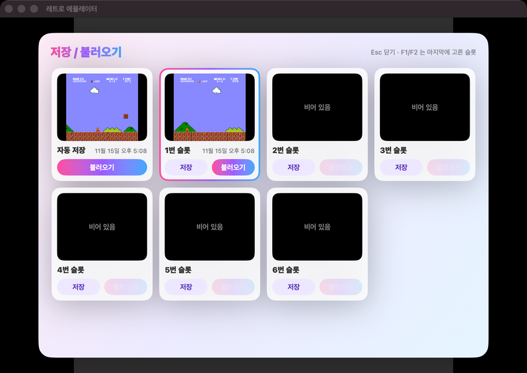
  
</p>

- 게임마다 **슬롯 6칸 + 자동 저장 1칸**이 있어요. 칸마다 저장한 순간의 화면과 시각이 남아요.
- 5초 넘게 하고 나가면 자동 저장돼요. 다음에 그 게임을 켜면 저장 목록부터 떠서 바로 이어할 수 있어요.
- 안드로이드는 홈 버튼이나 화면 잠금으로 앱이 뒤로 가도 그 자리에서 멈추고 자동 저장해요. 그래서 시스템이 앱을 꺼도 진행이 남아요.
- 이미 저장된 칸에 덮어쓸 땐 한 번 물어봐요.
- 배터리 세이브(게임 안의 세이브)도 따로 저장돼요. 10초마다, 그리고 나갈 때 써요.
- 저장 파일은 다 쓴 다음에 바꿔치기해서, 저장하다 꺼져도 예전 저장은 남아요.

### 게임 메뉴와 조작법 (맥·윈도우)

<p>
  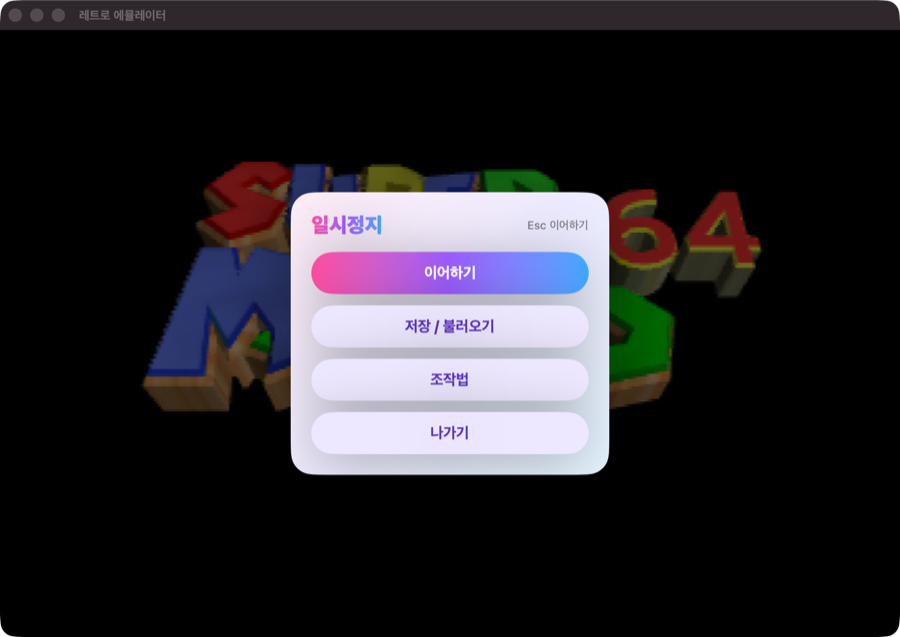
  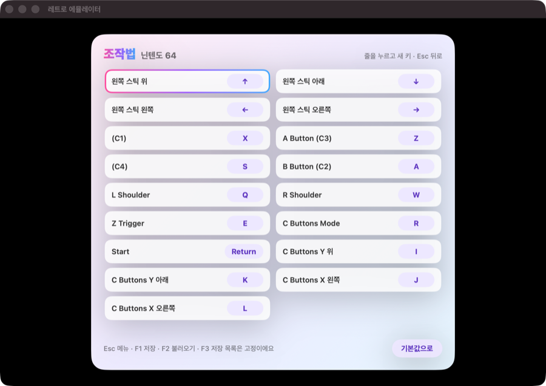
</p>
<p>
  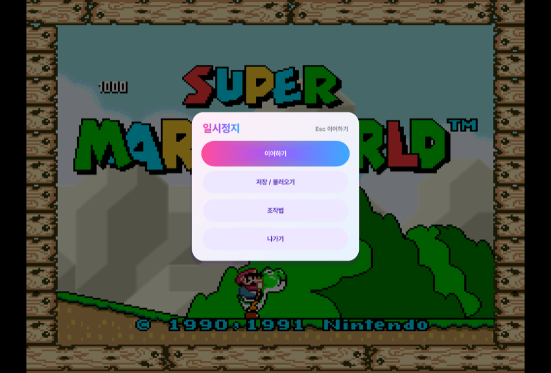
  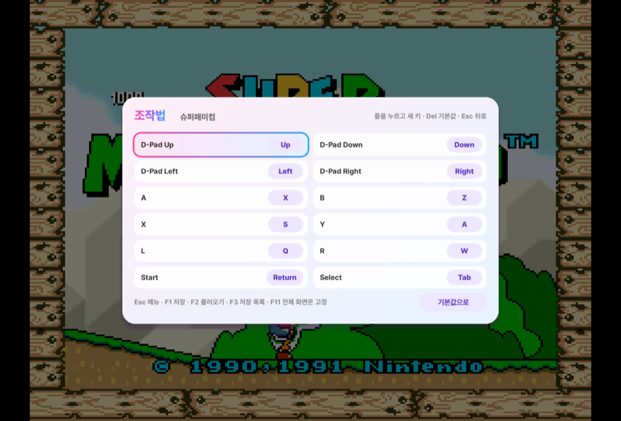
</p>

- 게임 중에 **Esc**를 누르면 꺼지지 않고 일시정지 메뉴가 떠요. **이어하기 · 저장/불러오기 · 조작법 · 나가기**가 있고, Esc를 한 번 더 누르면 게임으로 돌아가요. 패드는 셀렉트+스타트로 열어요.
- **조작법**에서는 그 기종의 버튼마다 지금 어떤 키가 붙어 있는지 보여요. 버튼 이름은 코어가 알려 주는 걸 그대로 써서 기종마다 실제 게임기 이름으로 나와요(PSP는 Cross·Circle, N64는 C Buttons·Z Trigger, 게임큐브는 Z 등).
- 줄을 누르고(또는 방향키로 고르고 Enter) 새 키를 누르면 바뀌어요. 다른 버튼이 쓰던 키를 고르면 그쪽은 비워져요. Esc는 취소예요.
- 키 배정은 **기종마다 따로** 저장되고, **기본값으로**를 누르면 처음 배정으로 돌아가요.
- Esc, F1, F2, F3(윈도우는 F11도)은 메뉴용이라 게임 버튼으로 못 써요.

### 화면 돌리기

러브플러스처럼 DS를 책처럼 옆으로 들고 하는 게임은 화면이 누워서 나와요. 메뉴의 **화면 돌리기**(그대로 · 오른쪽으로 · 거꾸로 · 왼쪽으로)로 90도씩 돌려요. 게임마다 기억하고, 아래 화면 터치(마우스)도 돌린 방향에 맞춰 들어가요. 네 앱 모두 돼요(맥·윈도우는 Esc 메뉴, 폰은 게임 메뉴).

### 게임 잠금

<p>
  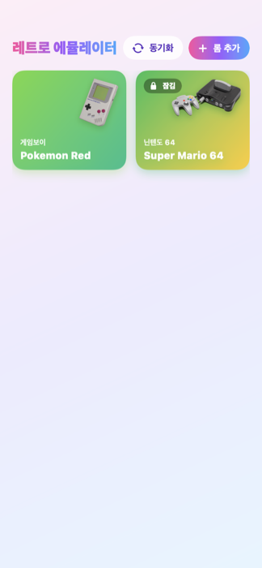
</p>

예전엔 게임이 비싸서 하나를 사면 그것만 끝까지 파고들었죠. 롬이 잔뜩 있으면 이것저것 찔러보다 끝나기 쉬워서, 그 시절처럼 **지금 하는 게임 하나에 집중**하려고 만든 기능이에요.

- 게임을 잠그면 카드가 흐려지고 **잠김** 표시가 붙어요. 목록에서 눌러도 안 켜져요.
- 잠그고 푸는 법: 맥은 카드를 **오른쪽 클릭**, 윈도우는 **오른쪽 클릭**이나 **L** 키, 안드로이드와 iOS는 카드를 **길게 눌러요**.
- 잠금을 풀 땐 경고가 떠요. "잠금 풀기"를 한 번 더 눌러야 풀려요.

  > 예전엔 게임이 비싸서 하나를 끝까지 파고들었죠. 잠금을 풀면 그 맛이 흐려져요. 지금 하는 게임을 충분히 즐긴 뒤에 푸는 걸 추천해요.

- 잠금은 기기마다 따로 저장돼요(동기화는 안 돼요).

### 기기 간 저장 동기화

- 맥, 윈도우, 안드로이드, iOS 어디서든 같은 **동기화 코드**를 넣으면 저장을 주고받아요. 게임 목록 위 **동기화** 버튼에서 켜요.
- 처음 기기에서 **새 코드**를 만들고, 다른 기기엔 그 코드를 그대로 넣어요.
- 게임을 켤 때 다른 기기의 새 저장을 받고, 슬롯에 저장하거나 나가거나 앱이 뒤로 갈 때 올려요. 그래서 폰에서 하다 나가면 맥에서 자동 저장부터 이어서 할 수 있어요.
- 슬롯 저장, 자동 저장, 썸네일, 게임 안 세이브(.srm)가 오가요. 파일마다 더 나중에 저장한 쪽이 이기고, 지운 슬롯은 다른 기기에서도 지워져요.
- 롬은 파일 이름으로 맞춰요. 기기마다 롬 파일 이름이 같아야 해요.
- 서버에 못 닿으면 그 기기 저장으로 그냥 시작하고, 다음에 닿을 때 맞춰요.
- 코드를 아는 사람은 그 저장을 받을 수 있어요. 서버는 코드 자체는 모르고, 코드로 만든 해시만 봐요.
- 서버 주소는 동기화 창에서 바꿔요.
  - **같은 와이파이**: 맥에 서버를 깔고(`./sync-server/install-mac.sh`, 로그인하면 자동으로 켜짐) 다른 기기에 맥 주소(예: `192.168.0.10:8270`)를 넣어요. 맥 앱 동기화 창에 넣을 주소가 나오고, 맥 자신은 **이 맥** 버튼을 눌러요.
  - **테일스케일**: 파이에 서버를 올리면(`./sync-server/deploy.sh`) **파이(테일스케일)** 버튼 주소로 밖에서도 돼요.

### 맥

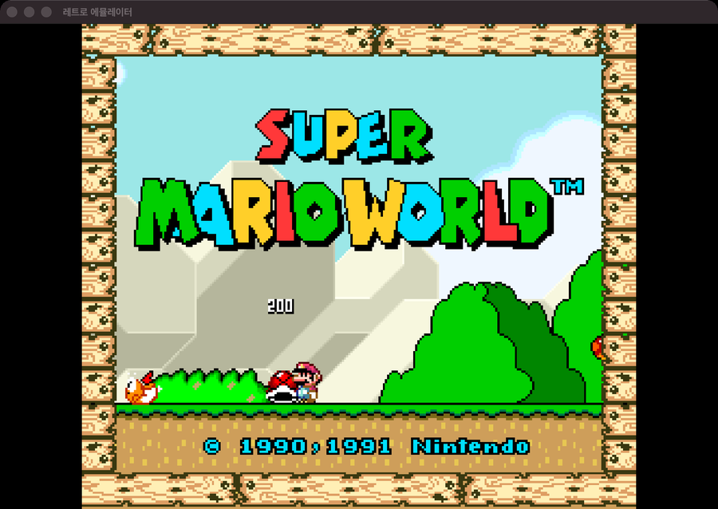

- 롬 파일을 창에 끌어다 놓거나 **롬 추가**로 넣어요. zip이면 풀어서 롬만 꺼내요.
- 게임패드를 연결하면 바로 써져요. 버튼은 위치 기준이라 어느 패드든 같은 자리로 눌려요(아래=B, 오른쪽=A, 왼쪽=Y, 위=X).

- N64·게임큐브는 방향키가 왼쪽 스틱으로 들어가요. 게임패드 스틱은 아날로그 기종에서 그대로 아날로그로 들어가요.

기본 키예요. 버튼 키(방향, A/B/X/Y, L/R, 스타트, 셀렉트, 오른쪽 스틱)는 Esc 메뉴의 **조작법**에서 기종마다 바꿀 수 있어요.

| 키 | 동작 |
|---|---|
| 방향키 | 방향 |
| Z / X | B / A |
| A / S | Y / X |
| Q / W | L / R |
| E / R | L2 / R2 |
| Return | 스타트 |
| Tab | 셀렉트 |
| I / J / K / L | 오른쪽 스틱(N64는 C 버튼) |
| 마우스 | DS 아래 화면 터치 |
| F1 / F2 | 저장 / 불러오기 (마지막에 고른 슬롯) |
| F3 | 저장 목록 |
| Esc | 일시정지 메뉴(이어하기·저장/불러오기·조작법·나가기), 열린 창 닫기 |

### 윈도우

<p>
  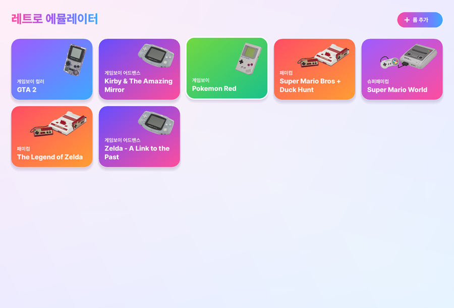
  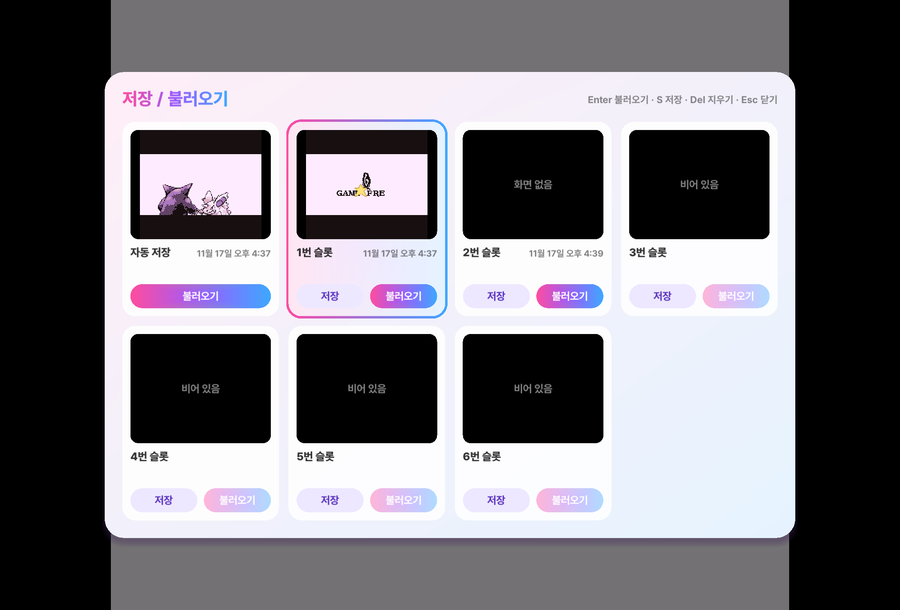
</p>

- 설치 없이 폴더째 두고 `RetroEmu.exe`를 실행해요. 윈도우 10 이상, 64비트.
- 롬을 창에 끌어다 놓거나 **롬 추가**(Ctrl+O)로 넣어요. 넣은 롬은 `%APPDATA%\RetroEmu\roms`에 복사돼요.
- 키는 맥과 같고, 더해서 F11이나 Alt+Enter로 전체 화면이에요.
- 마우스 없이도 돼요. 목록과 저장 목록은 방향키와 Enter, 패드 십자키와 버튼으로 움직여요.
- 목록에서 오른쪽 클릭하면 **잠그기/잠금 풀기 · 목록에서 지우기** 메뉴가 떠요. 키보드로는 L이 잠금, Delete가 지우기예요. 저장 목록에서는 S가 저장, Delete가 지우기예요.
- 조작법 화면에서 Delete는 그 기종 키를 기본값으로 돌려요.
- 게임패드(엑스박스, 플스, 스위치 프로 등)는 연결하면 바로 써져요. 셀렉트+스타트나 가운데 홈 버튼으로 일시정지 메뉴를 열어요.
- 화면은 SDL2로 그려요. 같은 코드를 맥에서도 빌드할 수 있어서 위 스크린샷은 맥에서 띄운 거예요.

### 안드로이드


- 오른쪽 위 **+** 로 롬을 가져와요. 여러 개를 한 번에 고를 수 있고(파일 선택 창에서 길게 눌러 모두 선택), zip이면 풀어서 롬만 꺼내요. 몇 GB짜리 게임큐브·PSP 게임은 가져오는 데 몇 분 걸리고, 그동안 진행 상황이 떠요.
- 카드를 길게 누르면 **잠그기/잠금 풀기 · 홈 화면에 추가 · 목록에서 지우기**가 나와요. **홈 화면에 추가**로 만든 아이콘(기종 색 바탕에 게임기 사진)을 누르면 그 게임이 바로 켜져요. 잠긴 게임은 바로가기로도 안 켜져요.
- 터치 버튼은 기종에 맞게 나와요(어깨 버튼, X/Y 버튼은 있는 기종에만).
- 게임 중 오른쪽 위 메뉴에서 바꿀 수 있어요.
  - **버튼 크기**: 기존 / 크게
  - **방향키**: 십자키 / 조이스틱 (조이스틱은 8방향으로 들어가요)
- 블루투스나 USB 게임패드를 연결하면 터치 버튼이 사라지고 화면이 커져요. 셀렉트와 스타트를 같이 누르면 메뉴가 열려요.
- 게임 화면은 네이티브 코드가 SurfaceView에 바로 그려요. 픽셀은 정수배로 키워서 선명하고, 갤럭시 A32에서 60fps로 돌아요.
- 세로, 가로 화면 둘 다 돼요.

### iOS

<p>
  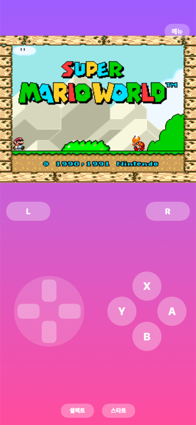
  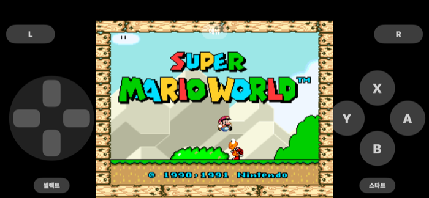
</p>

- 안드로이드판과 같은 화면이에요. 세로는 위에 게임, 아래에 버튼이고, 가로는 게임 위에 반투명 버튼이 겹쳐요.
- **롬 추가**로 파일 앱에서 롬을 고르거나, 파일 앱의 **나의 iPhone > 레트로 에뮬** 폴더에 롬을 넣어요. zip도 풀어서 넣어요.
- 카드를 길게 누르면 **잠그기/잠금 풀기 · 지우기**가 나와요.
- 메뉴에서 버튼 크기(기존/크게)와 방향키(십자키/조이스틱)를 바꿔요.
- 게임패드(MFi, 엑스박스, 플스)와 블루투스 키보드를 쓸 수 있어요. 셀렉트+스타트, 홈 버튼, Esc로 메뉴를 열어요.
- 홈 화면으로 나가거나 화면을 잠그면 멈추고 자동 저장해요.
- 앱 스토어 앱이 아니라서 AltStore, Sideloadly 같은 사이드로딩 도구로 설치해야 해요. 맥 Catalyst와 iOS 시뮬레이터에서 화면과 저장을 점검했고, 실제 아이폰에서는 아직 시험하지 못했어요.

## 빌드

먼저 코어를 받아요. libretro 공식 빌드봇에서 맥용과 안드로이드용(arm64)을 같이 받아요.

```bash
./fetch-cores.sh
```

### 맥

Swift 툴체인(Xcode 명령줄 도구)이 필요해요. `/Applications/RetroEmu.app`에 깔려요(쓰기 권한이 없으면 `~/Applications`).

```bash
./mac/build-app.sh
```

배포용 dmg는 이렇게 만들어요. `mac/dist/RetroEmu-mac-arm64.dmg`가 나와요.

```bash
./mac/make-dmg.sh
```

명령줄로 바로 열 수도 있어요.

```bash
open -a RetroEmu --args --rom /경로/게임.gba
```

### 윈도우

맥에서 [zig](https://ziglang.org/)로 교차 컴파일해요(`brew install zig`). SDL2, SDL2_ttf, 글꼴, 이미지 헤더는 `fetch-deps.sh`가 `windows/vendor/`에 받아요.

```bash
./fetch-cores.sh windows
./windows/fetch-deps.sh
./windows/build.sh
```

`windows/dist/RetroEmu-windows-x64.zip`이 나와요. 안에 exe, SDL DLL, 코어, 글꼴, 게임기 사진, `읽어보기.txt`가 들어 있어요.

맥에서 윈도우판 화면을 바로 확인하려면 같은 코드를 맥용으로 빌드해요(`brew install sdl2 sdl2_ttf`). 실행 파일 옆에 `fonts/`와 `consoles/` 폴더가 있어야 해서, `windows/dist/RetroEmu/` 안에서 빌드하면 편해요.

```bash
cd windows
clang -O2 $(sdl2-config --cflags) -I../host/include -I../host -Ivendor/stb main.c ../host/rhost.c \
  -o dist/RetroEmu/retro-sdl $(sdl2-config --libs) -lSDL2_ttf
dist/RetroEmu/retro-sdl --cores ../cores/mac
```

`--script "wait:60,key:Return,shot:a.png,quit"`를 주면 키 입력과 스크린샷을 순서대로 해서 화면을 자동으로 점검할 수 있어요.

### 안드로이드

Android SDK와 NDK `27.2.12479018`이 필요해요. 폰에는 릴리스 빌드로 까는 걸 권해요. 디버그 빌드는 화면이 눈에 띄게 느려요.

```bash
cd android
./gradlew assembleRelease
adb install -r app/build/outputs/apk/release/app-release.apk
```

릴리스 빌드는 디버그 키로 서명돼요. 직접 배포하려면 `android/app/build.gradle.kts`의 서명 설정을 바꾸세요.

### 동기화 서버

`sync-server/server.py` 하나로 돌아요(파이썬 표준 라이브러리만). 앱에 들어 있는 기본 주소는 만든 사람의 라즈베리파이예요. 직접 띄우려면 이렇게 하고, 앱 쪽 기본 주소(`Sync.swift`, `Sync.kt`, `windows/sync.h`)를 바꾸세요.

```bash
PORT=8270 DATA=~/retro-sync-data python3 sync-server/server.py
```

점검할 땐 맥·iOS·윈도우판은 `RETROEMU_SYNC=http://127.0.0.1:8270/retro-sync` 환경변수로 서버를 바꿀 수 있어요. 안드로이드 단위 테스트(`SyncTest`)는 이 서버를 띄워 두면 두 기기 주고받기를 실제로 해 봐요.

### iOS

Xcode 프로젝트 없이 `swiftc`로 바로 빌드해요. Xcode(iOS SDK)가 필요해요. 기기용은 서명 안 된 ipa가 나와서 사이드로딩 도구가 다시 서명해요.

```bash
./fetch-cores.sh ios
./ios/build.sh device     # ios/dist/RetroEmu-ios.ipa
./ios/build.sh sim        # arm64 시뮬레이터용 앱
```

Xcode가 없는 맥에서도 `./ios/build.sh catalyst`로 같은 UIKit 화면을 맥 앱으로 띄워 볼 수 있어요(코어는 맥용). `--rom 파일`, `--size 390x844`, `--shot 파일.png 초`로 화면을 자동으로 찍을 수 있어요. 깃허브 액션(`.github/workflows/ios.yml`)이 시뮬레이터에서 띄워 보고 ipa를 만들어요.

## 저장 파일 위치

| | 위치 |
|---|---|
| 맥 | `~/Library/Application Support/RetroEmu/` (`roms/`, `saves/`, `system/`) |
| 윈도우 | `%APPDATA%\RetroEmu\` (`roms\`, `saves\`, `system\`) |
| 안드로이드 | 앱 내부 저장소 `files/` (`roms/`, `saves/`, `system/`) |
| iOS | 앱의 Documents (파일 앱에서 보임, `roms/`, `saves/`, `system/`) |

- 맥: 키 배정은 앱 설정(`defaults read com.hayoonjae.retroemu`의 `keymap.<기종>`), 잠금은 `library.json`의 `locked`.
- 윈도우: 키 배정은 `keys.txt`, 잠금은 `locked.txt`(롬 파일 이름 한 줄씩).
- 안드로이드·iOS: 잠금은 앱 설정에 롬 파일 이름으로.

`saves/` 안의 이름은 `<롬 파일 이름>.<슬롯>.state`(상태), `.png`(썸네일), `.srm`(배터리 세이브)이에요. 슬롯은 `auto`, `1`~`6`이에요.

## 구조

```
host/      공용 C 호스트(rhost). 코어를 dlopen 해서 영상(RGBA), 소리, 입력, 저장을 처리
mac/       SwiftUI 앱 + build-app.sh
windows/   SDL2 앱(main.c) + build.sh(zig 교차 컴파일). 맥에서도 빌드돼서 화면 점검에 쓴다
ios/       SwiftUI + UIKit 앱 + build.sh(swiftc). 터치 버튼은 UIView 하나가 여러 손가락을 같이 처리
android/   Jetpack Compose 앱 + JNI(ndk-build). jni.c 가 rhost 와 SurfaceView 출력을 잇는다
sync-server/ 저장 동기화 서버(server.py, 맥 상주 install-mac.sh, 파이 배포 deploy.sh)
assets/    앱 아이콘, 게임기 사진
tests/     테스트용 패미컴 롬을 직접 만드는 스크립트(mk_nes.py)와 그 롬
docs/      README 스크린샷
```

`host/test.c`는 코어와 롬만 넣어서 몇 프레임 돌리고 마지막 화면을 `out.ppm`으로 저장하는 점검용 프로그램이에요.

```bash
clang -O2 -Ihost/include -Ihost host/rhost.c host/test.c -o rtest
./rtest cores/mac/mgba_libretro.dylib 게임.gbc 600
```

## 출처와 라이선스

- 게임기 사진은 위키미디어 공용의 퍼블릭 도메인 사진이에요. 파일별 출처는 [assets/consoles/CREDITS.md](assets/consoles/CREDITS.md)에 있어요.
- 코어는 저장소에 들어 있지 않고 `fetch-cores.sh`가 받아요. 코어마다 라이선스가 달라요. FCEUmm과 PCSX ReARMed는 GPLv2, mGBA는 MPL 2.0이고, Snes9x와 Genesis Plus GX는 비상업적 사용만 허락해요.
- `host/libretro.h`는 libretro API 헤더예요(MIT).
- 윈도우판은 SDL2·SDL2_ttf(zlib), 글꼴 Pretendard(SIL OFL), stb_image(퍼블릭 도메인)를 써요. 배포 zip의 `licenses/`에 원문이 들어 있어요.
