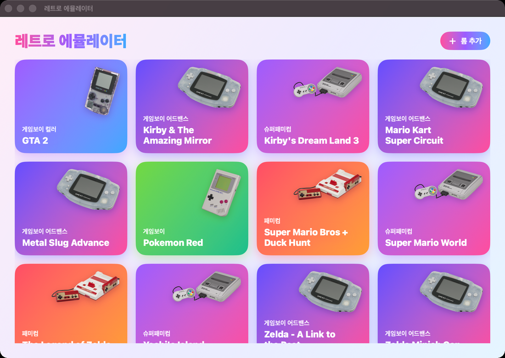
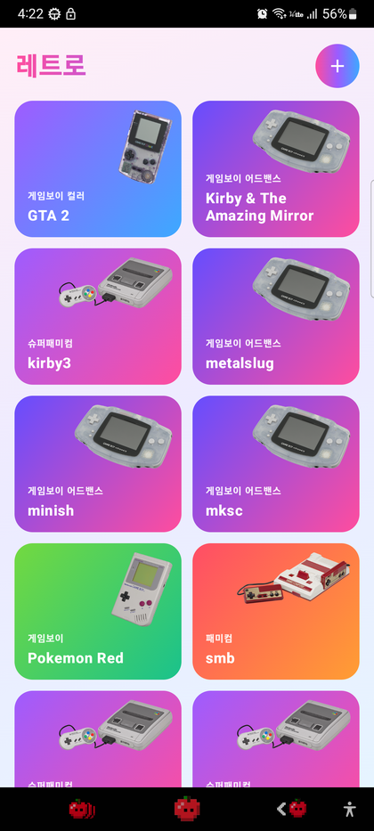
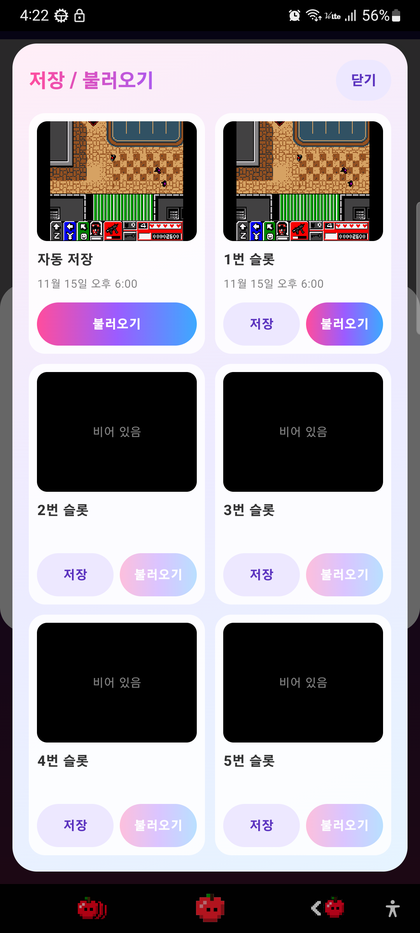
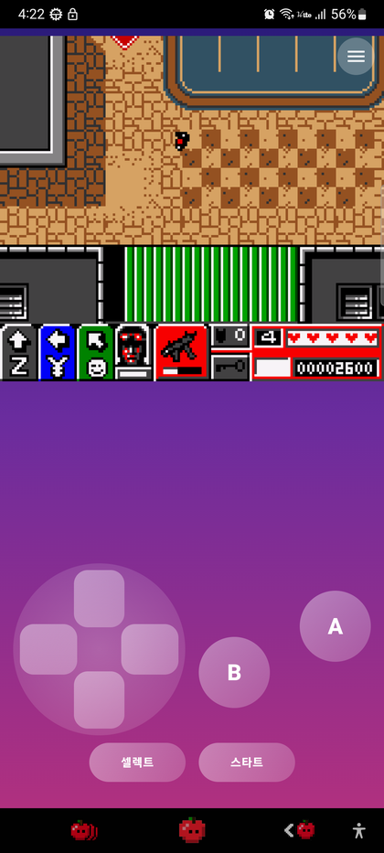

# retro-emu

맥과 안드로이드에서 도는 고전 게임 에뮬레이터예요. 에뮬레이션은 [libretro](https://www.libretro.com/) 코어가 하고, 이 저장소는 그 코어를 불러서 화면, 소리, 입력, 저장을 맡는 작은 호스트와 두 앱을 담고 있어요.

<p>
  
  
</p>

## 되는 기종

| 기종 | 확장자 | 코어 |
|---|---|---|
| 패미컴 | `.nes` `.fds` `.unf` | FCEUmm |
| 게임보이 | `.gb` | mGBA |
| 게임보이 컬러 | `.gbc` | mGBA |
| 게임보이 어드밴스 | `.gba` | mGBA |
| 슈퍼패미컴 | `.sfc` `.smc` `.swc` `.fig` | Snes9x |
| 메가드라이브 | `.md` `.gen` `.smd` `.bin` | Genesis Plus GX |
| 플레이스테이션 | `.cue` `.chd` `.pbp` `.m3u` | PCSX ReARMed |

- 롬은 들어 있지 않아요. 가지고 있는 롬을 직접 넣어야 해요.
- 플레이스테이션은 BIOS 없이 HLE로 돌아서 호환성이 낮아요. 필요하면 `scph5501.bin`을 시스템 폴더에 두세요.
- 게임보이 게임은 슈퍼 게임보이 색은 쓰고 테두리는 빼서 화면을 크게 보여줘요.

## 기능

### 저장

<p>
  
  
</p>

- 게임마다 **슬롯 6칸 + 자동 저장 1칸**이 있어요. 칸마다 저장한 순간의 화면과 시각이 남아요.
- 5초 넘게 하고 나가면 자동 저장돼요. 다음에 그 게임을 켜면 저장 목록부터 떠서 바로 이어할 수 있어요.
- 안드로이드는 홈 버튼이나 화면 잠금으로 앱이 뒤로 가도 그 자리에서 멈추고 자동 저장해요. 그래서 시스템이 앱을 꺼도 진행이 남아요.
- 이미 저장된 칸에 덮어쓸 땐 한 번 물어봐요.
- 배터리 세이브(게임 안의 세이브)도 따로 저장돼요. 10초마다, 그리고 나갈 때 써요.
- 저장 파일은 다 쓴 다음에 바꿔치기해서, 저장하다 꺼져도 예전 저장은 남아요.

### 맥


- 롬 파일을 창에 끌어다 놓거나 **롬 추가**로 넣어요. zip이면 풀어서 롬만 꺼내요.
- 게임패드를 연결하면 바로 써져요. 버튼은 위치 기준이라 어느 패드든 같은 자리로 눌려요(아래=B, 오른쪽=A, 왼쪽=Y, 위=X).

| 키 | 동작 |
|---|---|
| 방향키 | 방향 |
| Z / X | B / A |
| A / S | Y / X |
| Q / W | L / R |
| E / R | L2 / R2 |
| Return | 스타트 |
| Delete, Tab | 셀렉트 |
| F1 / F2 | 저장 / 불러오기 (마지막에 고른 슬롯) |
| F3 | 저장 목록 |
| Esc | 저장 목록 닫기, 게임 나가기 |

### 안드로이드



- 오른쪽 위 **+** 로 롬을 가져와요. zip이면 풀어서 롬만 꺼내요.
- 터치 버튼은 기종에 맞게 나와요(어깨 버튼, X/Y 버튼은 있는 기종에만).
- 게임 중 오른쪽 위 메뉴에서 바꿀 수 있어요.
  - **버튼 크기**: 기존 / 크게
  - **방향키**: 십자키 / 조이스틱 (조이스틱은 8방향으로 들어가요)
- 블루투스나 USB 게임패드를 연결하면 터치 버튼이 사라지고 화면이 커져요. 셀렉트와 스타트를 같이 누르면 메뉴가 열려요.
- 게임 화면은 네이티브 코드가 SurfaceView에 바로 그려요. 픽셀은 정수배로 키워서 선명하고, 갤럭시 A32에서 60fps로 돌아요.
- 세로, 가로 화면 둘 다 돼요.

## 빌드

먼저 코어를 받아요. libretro 공식 빌드봇에서 맥용과 안드로이드용(arm64)을 같이 받아요.

```bash
./fetch-cores.sh
```

### 맥

Swift 툴체인(Xcode 명령줄 도구)이 필요해요. `/Applications/RetroEmu.app`에 깔려요(쓰기 권한이 없으면 `~/Applications`).

```bash
./mac/build-app.sh
```

명령줄로 바로 열 수도 있어요.

```bash
open -a RetroEmu --args --rom /경로/게임.gba
```

### 안드로이드

Android SDK와 NDK `27.2.12479018`이 필요해요. 폰에는 릴리스 빌드로 까는 걸 권해요. 디버그 빌드는 화면이 눈에 띄게 느려요.

```bash
cd android
./gradlew assembleRelease
adb install -r app/build/outputs/apk/release/app-release.apk
```

릴리스 빌드는 디버그 키로 서명돼요. 직접 배포하려면 `android/app/build.gradle.kts`의 서명 설정을 바꾸세요.

## 저장 파일 위치

| | 위치 |
|---|---|
| 맥 | `~/Library/Application Support/RetroEmu/` (`roms/`, `saves/`, `system/`) |
| 안드로이드 | 앱 내부 저장소 `files/` (`roms/`, `saves/`, `system/`) |

`saves/` 안의 이름은 `<롬 파일 이름>.<슬롯>.state`(상태), `.png`(썸네일), `.srm`(배터리 세이브)이에요. 슬롯은 `auto`, `1`~`6`이에요.

## 구조

```
host/      공용 C 호스트(rhost). 코어를 dlopen 해서 영상(RGBA), 소리, 입력, 저장을 처리
mac/       SwiftUI 앱 + build-app.sh
android/   Jetpack Compose 앱 + JNI(ndk-build). jni.c 가 rhost 와 SurfaceView 출력을 잇는다
assets/    앱 아이콘, 게임기 사진
tests/     테스트용 패미컴 롬을 직접 만드는 스크립트(mk_nes.py)와 그 롬
docs/      README 스크린샷
```

`host/test.c`는 코어와 롬만 넣어서 몇 프레임 돌리고 마지막 화면을 `out.ppm`으로 저장하는 점검용 프로그램이에요.

```bash
clang -O2 -Ihost/include -Ihost host/rhost.c host/test.c -o rtest
./rtest cores/mac/mgba_libretro.dylib 게임.gbc 600
```

## 출처와 라이선스

- 게임기 사진은 위키미디어 공용의 퍼블릭 도메인 사진이에요. 파일별 출처는 [assets/consoles/CREDITS.md](assets/consoles/CREDITS.md)에 있어요.
- 코어는 저장소에 들어 있지 않고 `fetch-cores.sh`가 받아요. 코어마다 라이선스가 달라요. FCEUmm과 PCSX ReARMed는 GPLv2, mGBA는 MPL 2.0이고, Snes9x와 Genesis Plus GX는 비상업적 사용만 허락해요.
- `host/libretro.h`는 libretro API 헤더예요(MIT).
